  

  
  

👋 I'm Dex. I study Information Systems at UKDW in Yogyakarta and build things that have to work in front of strangers: a judge with five minutes, a classroom, a wedding guest with no crypto wallet.

🧥 The hooded one in the banner is Si Style, my old handle with a body. 🐧 The penguin is his friend, and he is hard to impress. Both of them read this page before you did.

## 🪜 The ladder

One rung per thing that shipped or placed, newest on top. The last column says what I did myself, because a team result and a solo build are different things.

| | When | Rung | My part |
|---|---|---|---|
| 🚧 | Now | **Amplop Balas** (working title), an entry for the NEAR Hackathon. Digital wedding envelopes: guests give by QR with no wallet, and the envelope remembers who gave, so the favor can be returned when it's their turn. [Live](https://amplop-balas.vercel.app) | Still being built. |
| 🥉 | 31 Oct 2026 | Essay competition UKK Uphoria 2026 (UGM), **3rd place** | Solo essay. |
| 🥈 | 31 Oct 2026 | Indonesia Web3 Hackathon 2026, Demo Day, Track 3 Consumer Apps, **2nd place** with Lencana | Team of three. I worked on the UI, and Dave and I pitched. |
| 🧾 | 29 Oct 2026 | **BonBagi**, submitted to ZECATHON (Shielded Payments). One Zcash payment splits across a group in a single transaction, no treasurer. [Live](https://bonbagi.vercel.app) | My solo entry. Submitted, no result yet. |
| 🥈 | 24 Oct 2026 | Monad Blitz Jogja Vol. 2, **2nd place** with PrintPitt, where nearby print shops race for each order onchain, live on Monad mainnet. [Landing](https://printpitt-landing.vercel.app) | Team of three. I built the landing page and README, and pitched. |
| 🥈 | 21 Aug 2026 | International Business Plan Competition BMC #12, Politeknik Negeri Bali, **2nd place** (1st runner-up) with [EMITRA](https://emitra-app.vercel.app/), a CBAM compliance platform for Indonesian steel and aluminium exporters | Team of four. Presented in English with Adriel. |
| 🏆 | 10 Jul 2026 | Mantle Turing Test Hackathon, **track winner** (Consumer & Viral DApps) with [Cult of the Digital Oracle](https://cult-oracle.vercel.app/) | Team of three, Dave led. I made the UI assets and docs, and gave the pitch. |
| 🥇 | 2 May 2026 | KSE, Universitas Sumatera Utara, **1st place** with Sowan.id (team MAKOSAN) | Team of three. The idea was Sowan.id, which is also my thesis. |

Nothing on it is rounded up. Stats widgets can wait. The ladder is the record.

## 🧰 What I reach for

🐧 Penguin's review of this README: unimpressed. Approved anyway.
